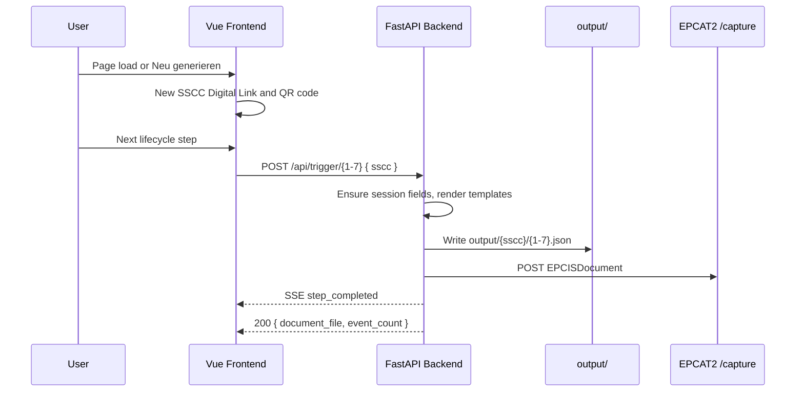

# Demonstrator model

Lightweight demo of construction-material tracking in the Construct-X dataspace:

- GS1 SSCC as a Digital Link URI, shown as a QR code
- LGTINs, despatch advice, and purchase order filled in by the backend when a step needs them
- EPCIS 2.0 events from JSON templates, wrapped in one `EPCISDocument` per step
- POST to the EPCAT2 capture API (no dataspace connector)

## Flow

Principles: template-driven events, one document per step, steps only in order, documents logged and written to disk.

## Identifiers

The browser session is only the SSCC. `frontend/src/utils/epcis-session.ts` builds `https://id.gs1.org/00/{18-digit-sscc}` with a GS1 check digit (`frontend/src/utils/sscc-check-digit.ts`).

`backend/epcis/session_store.py` keeps the rest in process memory, keyed by SSCC:

| Field | When set | Shape |
| --- | --- | --- |
| `lgtin1`, `lgtin2` | Steps that need material (`1`, `3`, `4`, `5`, `7`) | `https://id.gs1.org/01/{gtin}/10/{lot}` |
| `desadv`, `po` | Step 1 | `https://id.gs1.org/253/{prefix}{timestamp}` |

Both LGTINs share one lot. GTINs and prefixes are constants in `session_store.py`. Restarting the backend drops the session, so later steps cannot run until step 1 is triggered again.

## Lifecycle

Einbau is steps 1–3. Rückbau is steps 4–7.

| # | Step ID | Label | Templates | Output |
| --- | --- | --- | --- | --- |
| 1 | `ausgang-hersteller` | Ausgang beim Hersteller | `01.json`, `02a.json`, `03.json`, `04.json` | `1.json` |
| 2 | `baustellen-eingang` | Baustellen-Eingang | `05.json` | `2.json` |
| 3 | `einbau` | Einbau | `06a.json`, `06b.json` | `3.json` |
| 4 | `rueckbau` | Rückbau | `07a.json` | `4.json` |
| 5 | `ausgang-baustelle` | Ausgang Baustelle | `07b.json`, `08.json` | `5.json` |
| 6 | `eingang-hersteller` | Eingang beim Hersteller | `09.json` | `6.json` |
| 7 | `aufbereitung` | Aufbereitung | `02b.json` | `7.json` |

Registry: `backend/epcis/steps.py`. Button labels and images: `frontend/src/constants/steps.ts`.

Which event-path files each business step raises, including the Einbau step Umlagerung, is in [Business steps](./epcis-eventstrecke/README.md#business-steps).
