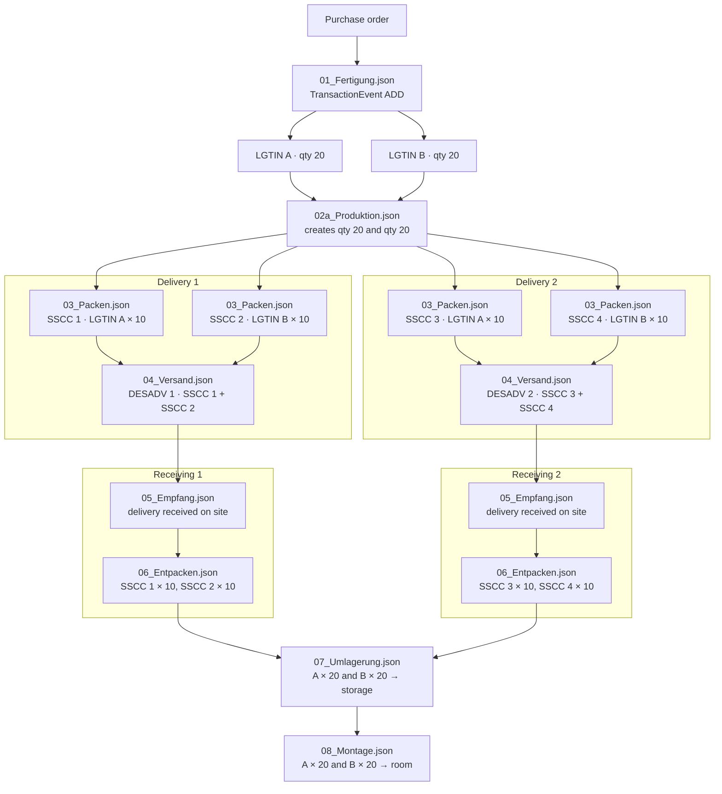

# EPCIS event path

These JSON files are the event shapes for the Lindner material path. Ingestion raises one Fertigung and one Produktion for the ordered quantities, then four packing events and two dispatch advices so two deliveries can each carry two pallets. On site, each delivery is received and unpacked. Both deliveries then join for one Umlagerung and one Montage.

Files that are raised more than once contain a JSON array of those events, in time order. `02b_Produktion.json`, `09_Demontage.json`, `10_Packen.json`, `11_Versand_an_Lindner.json`, and `12_Empfang_bei_Lindner.json` continue the return path and are not part of the graph below. `lindner.zip` is an extra sample. `backend/epcis-original/` is a separate reference copy and is not loaded at runtime.

## Ingestion

Fertigung ties the purchase order to both class quantities. Produktion creates those same quantities. Each packing puts one LGTIN on its own SSCC. Each dispatch advice ships the two SSCCs of one delivery (one pallet of each LGTIN).

| File                  | Raised | Connects                                                   |
| --------------------- | ------ | ---------------------------------------------------------- |
| `01_Fertigung.json`   | 1      | PO → LGTIN A qty 20 and LGTIN B qty 20                     |
| `02a_Produktion.json` | 1      | Creates those same quantities                              |
| `03_Packen.json`      | 4      | Each SSCC holds 10. SSCC 1 and 3 are A, SSCC 2 and 4 are B |
| `04_Versand.json`     | 2      | DESADV 1 ships SSCC 1+2. DESADV 2 ships SSCC 3+4           |
| `05_Empfang.json`     | 2      | One receiving event per DESADV, on the construction site   |
| `06_Entpacken.json`   | 4      | Removes 10 from each SSCC                                  |
| `07_Umlagerung.json`  | 1      | Both deliveries join. A×20 and B×20 move to storage        |
| `08_Montage.json`     | 1      | After Umlagerung. Installs A×20 and B×20 in a room         |

LGTIN A is `01/04047111793267/10/1a2b`. LGTIN B is `01/04047111288459/10/3c4d`. Both quantities are 20, packed as 10 per pallet.

