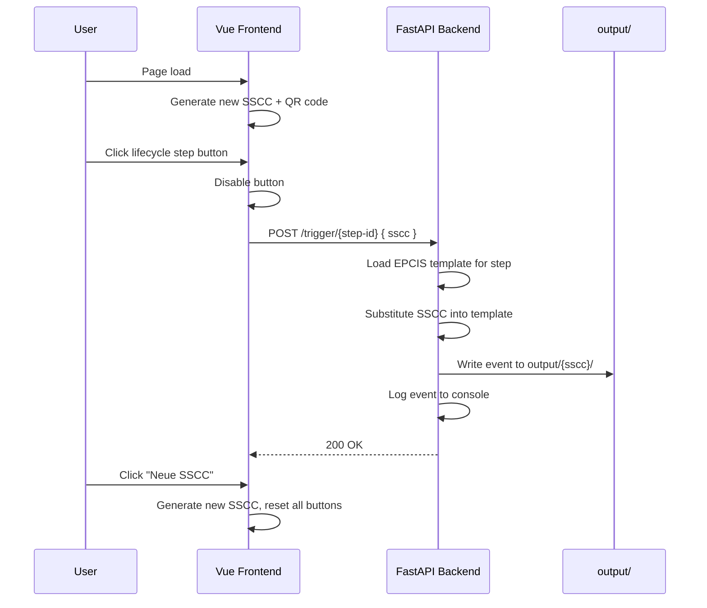

# Construct-X Demonstrator — Development Documentation

> Living document. Add notes, decisions, and learnings here as development progresses.

## Table of Contents

1. [Project Goal](#project-goal)
2. [Project Initialization](#project-initialization)
3. [System Overview](#system-overview)
4. [GS1 SSCC & Digital Link](#gs1-sscc--digital-link)
5. [Lifecycle Workflow](#lifecycle-workflow)
6. [Frontend](#frontend)
7. [Backend](#backend)
8. [EPCIS Templates](#epcis-templates)
9. [Docker & Deployment](#docker--deployment)
10. [API Reference](#api-reference)
11. [Development Log](#development-log)

---

## Project Goal

Build a **demonstrator** for the Construct-X Dataspace that shows how construction materials can be tracked through their lifecycle using:

- **GS1 SSCC** identifiers encoded as **GS1 Digital Link** URIs
- **EPCIS 2.0** events generated from templates
- A simple web UI that simulates QR-code scans at each lifecycle stage

The demo is intentionally lightweight: no real dataspace connector, no external EPCIS repository — just local event generation, file persistence, and console logging.

---

## Project Initialization

> **Do not hand-roll project scaffolding.** Use the official tools below so the stack, tooling, and conventions stay correct.

### Frontend (Vue + Vuetify)

Scaffold with [create-vue](https://github.com/vuejs/create-vue) and add Vuetify via its Vite plugin:

```bash
cd frontend
npm create vue@latest .    # TypeScript, Vue Router optional, Pinia optional
npm install
npm install vuetify vite-plugin-vuetify @mdi/font
```

After init, configure Vuetify in `vite.config.ts` and add file-watcher polling for Docker bind mounts:

```typescript
// vite.config.ts — required for HMR inside Docker on some hosts
export default defineConfig({
  server: {
    host: '0.0.0.0',
    port: 3000,
    watch: {
      usePolling: true,
    },
  },
})
```

The `Docker.dev` expects a `"dev"` script (provided by create-vue/Vite) and runs:

```bash
npm run dev -- --host 0.0.0.0 --port 3000
```

### Backend (FastAPI)

Started via Docker Compose — no local setup required. `Dockerfile.dev` sets `APP_ENV=development`, bind-mounts `./backend`, and the entrypoint creates `.venv` + installs dependencies on first start.

### Backend environment variables

Loaded via `pydantic-settings` based on `APP_ENV`:

| `APP_ENV` | Env file |
|-----------|----------|
| `development` | `.env.development` |
| `production` | `.env.production` |

Local overrides: `.env.development.local` or `.env.local` (gitignored).

| Variable | Development | Production |
|----------|-------------|------------|
| `LOG_LEVEL` | `DEBUG` | `INFO` |
| `CORS_ORIGINS` | `http://localhost:3000,...` | `https://demonstrator.example.com` |

Defaults (no need to set in env files): `APP_ENV` via process/Dockerfile, `OUTPUT_DIR=output` in `config.py`.

Docker dev sets `APP_ENV=development` in `Dockerfile.dev` and loads `.env.development` from the bind-mounted `./backend`. The production image sets `APP_ENV=production` in `Dockerfile` and bakes in `.env.production`.

The `Dockerfile.dev` expects:

- `requirements.txt` at the backend root (used at image build time)
- A FastAPI `app` instance in `main.py` at the backend root, importable as `main:app`
- Uvicorn started with `--reload` so Python file changes restart the process automatically

> Docker dev bind-mounts the **entire** `./backend` folder to `/backend`. The entrypoint creates `.venv` inside that mounted folder on first start.

### EPCIS templates folder

```bash
mkdir -p backend/epcis/templates
```

Place one JSON template per lifecycle step (see [EPCIS Templates](#epcis-templates)).

### Start dev environment

Once both projects are initialized:

```bash
docker compose up --build
```

| Service | Dev server | Hot-reload mechanism |
|---------|------------|----------------------|
| Frontend | Vite (`npm run dev`) | HMR via bind-mounted `./frontend` |
| Backend | Uvicorn (`--reload`) | Process restart on bind-mounted `./backend` changes |

No container restart is required for source edits. Rebuild the image only when dependencies change (`requirements.txt` / `package.json`).

---

## System Overview



### Design Principles

- **Simplicity over completeness** — the demo proves the concept, not production readiness
- **Template-driven events** — EPCIS payloads live in `backend/epcis/templates/` and can be edited without code changes
- **Idempotent UI state** — each SSCC tracks which steps have been executed; a new SSCC starts fresh
- **Observable output** — every generated event is logged to the backend console and written to disk

---

## GS1 SSCC & Digital Link

### SSCC (Serial Shipping Container Code)

An SSCC is an 18-digit identifier used to uniquely label logistic units (pallets, containers, etc.). In the demonstrator we generate random valid-length SSCCs for demo purposes.

### GS1 Digital Link

GS1 Digital Link encodes GS1 identifiers as web URIs. For SSCC (AI `00`):

```
https://id.gs1.org/00/{sscc}
```

Example:

```
https://id.gs1.org/00/006141411234567890
```

The frontend:

1. Generates a new SSCC on page load
2. Formats it as a GS1 Digital Link URI
3. Renders a QR code containing that URI
4. Sends the URI in API requests to the backend

### QR Code

The QR code on the page encodes the full Digital Link URI. In a real deployment this would be printed on a physical label; in the demo, the seven buttons simulate scanning it at different lifecycle points.

---

## Lifecycle Workflow

The demonstrator models a circular material flow in construction:

```
Hersteller ──► Baustelle ──► Einbau ──► Rückbau ──► Baustelle ──► Hersteller ──► Aufbereitung
   (1)            (2)          (3)        (4)          (5)            (6)            (7)
```

| # | Step ID | Label | EPCIS Intent (planned) |
|---|---------|-------|------------------------|
| 1 | `ausgang-hersteller` | Ausgang beim Hersteller | `ObjectEvent` — shipping / departing |
| 2 | `baustellen-eingang` | Baustellen-Eingang | `ObjectEvent` — receiving at site |
| 3 | `einbau` | Einbau | `TransformationEvent` or `ObjectEvent` — commissioning |
| 4 | `rueckbau` | Rückbau | `ObjectEvent` — decommissioning |
| 5 | `ausgang-baustelle` | Ausgang Baustelle | `ObjectEvent` — shipping from site |
| 6 | `eingang-hersteller` | Eingang beim Hersteller | `ObjectEvent` — receiving at manufacturer |
| 7 | `aufbereitung` | Aufbereitung | `TransformationEvent` — refurbishment |

> **Note:** Exact EPCIS event types and fields will be defined in the templates placed in `backend/epcis/templates/`.

### Frontend Button Behaviour

- All seven buttons are enabled when a new SSCC is generated
- Clicking a button calls `POST /trigger/{step-id}` with the current SSCC
- On success, the button is disabled (greyed out, not clickable)
- Clicking **"Neue SSCC generieren"** creates a new SSCC, re-renders the QR code, and re-enables all buttons

---

## Frontend

### Stack

| Tool | Version (planned) | Role |
|------|-------------------|------|
| Vue | 3.x | UI framework |
| Vuetify | 3.x | Material Design components |
| Vite | 5.x | Build tool / dev server |
| qrcode.vue (or similar) | latest | QR code rendering |

### Key Components (planned)

| Component | Responsibility |
|-----------|----------------|
| `App.vue` | Layout, SSCC state, step tracking |
| `SsccDisplay.vue` | Shows current Digital Link URI |
| `QrCode.vue` | Renders QR code for current SSCC |
| `LifecycleSteps.vue` | Seven step buttons with disabled state |
| `api/trigger.ts` | HTTP client for `POST /trigger/{step-id}` |
| `utils/sscc.ts` | SSCC generation and Digital Link formatting |

### SSCC Generation (planned logic)

```typescript
// Pseudocode — 18-digit SSCC with extension digit
function generateSscc(): string {
  const extensionDigit = Math.floor(Math.random() * 10)
  const serial = String(Math.floor(Math.random() * 1e16)).padStart(16, '0')
  const base = `${extensionDigit}${serial}`
  const checkDigit = computeGs1CheckDigit(base)
  return base + checkDigit
}

function toDigitalLink(sscc: string): string {
  return `https://id.gs1.org/00/${sscc}`
}
```

### Environment variables

Vite loads env files by mode:

| Mode | Command | Env file |
|------|---------|----------|
| `development` | `npm run dev` | `.env.development` |
| `production` | `npm run build` | `.env.production` |

Use `import.meta.env.VITE_*` in code, or import from `src/config/env.ts`:

```typescript
import { env } from '@/config/env'

fetch(`${env.backendBaseUrl}/trigger/ausgang-hersteller`, { method: 'POST', ... })
```

| Variable | Development | Production |
|----------|-------------|------------|
| `VITE_BACKEND_BASE_URL` | `http://localhost:8080/api` | `https://demonstrator.example.com/api` |

Local overrides: `.env.local` or `.env.development.local` (gitignored).

Docker dev uses the bind-mounted `.env.development` — do not duplicate vars in `docker-compose.yaml`.

---

## Backend

### Stack

| Tool | Version (planned) | Role |
|------|-------------------|------|
| Python | 3.12+ | Runtime |
| FastAPI | latest | Web framework |
| Uvicorn | latest | ASGI server |
| Jinja2 (optional) | latest | Template variable substitution |

### Application Structure (planned)

```
backend/
├── main.py                  # FastAPI app, routes
├── models.py                # Pydantic request/response models
├── config.py                # OUTPUT_DIR, template paths
├── output/                  # Generated EPCIS events (gitignored)
├── epcis/
│   ├── generator.py         # Load template, substitute SSCC, write file
│   ├── steps.py             # Step ID registry and validation
│   └── templates/
│       ├── ausgang-hersteller.json
│       ├── baustellen-eingang.json
│       ├── einbau.json
│       ├── rueckbau.json
│       ├── ausgang-baustelle.json
│       ├── eingang-hersteller.json
│       └── aufbereitung.json
├── Dockerfile
├── Dockerfile.dev
└── requirements.txt
```

### Event Generation Flow

1. Receive `POST /trigger/{step-id}` with `{ "sscc": "https://id.gs1.org/00/..." }`
2. Validate `step-id` against known steps
3. Load `backend/epcis/templates/{step-id}.json`
4. Replace placeholders (e.g. `{{SSCC}}`, `{{TIMESTAMP}}`) with actual values
5. Create directory `backend/output/{sscc}/` if it does not exist
6. Write event as `{step-id}.json` (or timestamped filename)
7. Log the full event JSON to stdout
8. Return confirmation response

### Persistence

| Path | Description |
|------|-------------|
| `backend/output/{sscc}/` | One folder per SSCC (SSCC extracted from Digital Link) |
| `backend/output/{sscc}/{step-id}.json` | Generated EPCIS event for that step |

The `output/` directory is gitignored and created automatically on first event.

### Placeholder Variables (planned for templates)

| Placeholder | Replaced with |
|-------------|---------------|
| `{{SSCC}}` | Full GS1 Digital Link URI |
| `{{SSCC_RAW}}` | 18-digit SSCC without URI prefix |
| `{{TIMESTAMP}}` | ISO 8601 UTC timestamp |
| `{{STEP_ID}}` | The step identifier |
| `{{EVENT_ID}}` | Generated UUID for the EPCIS event |

---

## EPCIS Templates

Templates are JSON files placed in `backend/epcis/templates/`. One file per lifecycle step.

### Template Format (example skeleton)

```json
{
  "@context": [
    "https://ref.gs1.org/standards/epcis/epcis-context.jsonld"
  ],
  "type": "EPCISDocument",
  "schemaVersion": "2.0",
  "creationDate": "{{TIMESTAMP}}",
  "epcisBody": {
    "eventList": [
      {
        "type": "ObjectEvent",
        "eventTime": "{{TIMESTAMP}}",
        "eventTimeZoneOffset": "+00:00",
        "epcList": ["{{SSCC}}"],
        "action": "OBSERVE",
        "bizStep": "shipping",
        "disposition": "in_transit"
      }
    ]
  }
}
```

> **Status:** Templates are to be provided and refined during development. The backend will load whatever JSON is present in the templates folder.

### Adding a New Step

1. Add a template JSON in `backend/epcis/templates/`
2. Register the step ID in `backend/epcis/steps.py`
3. Add a corresponding button in the frontend `LifecycleSteps.vue`

---

## Docker & Deployment

### Development (`docker-compose.yaml`)

Uses `Dockerfile.dev` for both services. **Requires initialized frontend and backend** (see [Project Initialization](#project-initialization)).

| Service | Image | Port | Notes |
|---------|-------|------|-------|
| `backend` | `backend/Dockerfile.dev` | 8000 | Uvicorn with `--reload`, full bind mount |
| `frontend` | `frontend/Docker.dev` | 3000 | Vite dev server with HMR, full bind mount |

**Hot-reload without container restart:**

- `./backend` and `./frontend` are fully bind-mounted into `/backend` and `/frontend`
- Backend entrypoint: creates `.venv` in the mounted folder if missing
- Frontend entrypoint: runs `npm ci` in the mounted folder if `node_modules` is missing

```yaml
services:
  backend:
    build:
      context: ./backend
      dockerfile: Dockerfile.dev
    ports:
      - "8000:8000"
    volumes:
      - type: bind
        source: ./backend
        target: /backend

  frontend:
    build:
      context: ./frontend
      dockerfile: Docker.dev
    ports:
      - "3000:3000"
    volumes:
      - type: bind
        source: ./frontend
        target: /frontend
```

### Production

| Service | Dockerfile | Notes |
|---------|------------|-------|
| Backend | `backend/Dockerfile` | Slim Python image, Uvicorn, no source mount |
| Frontend | `frontend/Dockerfile` | Multi-stage: `npm build` → nginx serving `dist/` |

Production images are built and deployed independently (no compose file planned yet).

---

## API Reference

### `POST /trigger/{step-id}`

Trigger EPCIS event generation for a lifecycle step.

**URL:** `/trigger/{step-id}`

**Valid step IDs:**

- `ausgang-hersteller`
- `baustellen-eingang`
- `einbau`
- `rueckbau`
- `ausgang-baustelle`
- `eingang-hersteller`
- `aufbereitung`

**Request body:**

```json
{
  "sscc": "https://id.gs1.org/00/006141411234567890"
}
```

**Success response (200):**

```json
{
  "step_id": "ausgang-hersteller",
  "sscc": "https://id.gs1.org/00/006141411234567890",
  "event_file": "ausgang-hersteller.json"
}
```

**Error responses:**

| Status | Condition |
|--------|-----------|
| 404 | Unknown `step-id` or missing template file |
| 422 | Invalid request body (missing `sscc`) |
| 500 | File system or template processing error |

### `GET /health`

Liveness probe — process is running.

```text
ok
```

### `GET /ready`

Readiness probe — app can serve traffic. Returns `503` when EPCIS templates are missing or `output/` is not writable.

```text
ok
```

---

## Development Log

Chronological notes recorded during development.

### 2026-07-15 — Dev Docker setup (no manual scaffold)

**Decisions made:**

- Removed hand-written Vue/FastAPI scaffold — projects will be initialized with official tools (`create-vue`, `fastapi new`)
- `Dockerfile.dev` runs dev servers (Vite, Uvicorn `--reload`) with bind-mounted source
- No container restart needed for code changes; rebuild image only on dependency changes
- Frontend `vite.config.ts` needs `server.watch.usePolling: true` for reliable HMR in Docker

### 2026-07-15 — Project kickoff

**Decisions made:**

- Vue 3 + Vuetify 3 for the frontend (per project requirements)
- Python FastAPI for the backend (per project requirements)
- GS1 Digital Link format for SSCC: `https://id.gs1.org/00/{sscc}`
- Seven lifecycle steps model a circular construction material flow (manufacturer → site → install → deconstruct → return → refurbish)
- API endpoint pattern: `POST /trigger/{step-id}` with SSCC in request body
- EPCIS events generated from JSON templates in `backend/epcis/templates/`
- Events persisted to `backend/output/{sscc}/` (gitignored)
- Events logged to backend console for easy debugging
- Separate Dockerfiles for dev (`Dockerfile.dev`) and prod (`Dockerfile`)
- `docker-compose.yaml` uses dev Dockerfiles with source mounts and hot-reload

**Open items:**

- [ ] Initialize frontend with `npm create vue@latest` + Vuetify
- [ ] Initialize backend with `fastapi new` (or chosen layout)
- [ ] EPCIS template JSON files (to be provided)
- [ ] Exact `bizStep` and `disposition` values per lifecycle step
- [ ] GS1 check digit algorithm implementation in frontend
- [ ] CORS configuration for frontend → backend in dev
- [ ] Production compose / orchestration setup
- [ ] Construct-X Dataspace connector integration (out of scope for demo)

**Questions to resolve:**

- Should duplicate triggers for the same step + SSCC be rejected or overwrite?
- Timestamped filenames vs. fixed `{step-id}.json` for event files?
- Should the backend expose a `GET /events/{sscc}` endpoint to inspect generated events?

---

*Add new dated entries above this line as development continues.*
