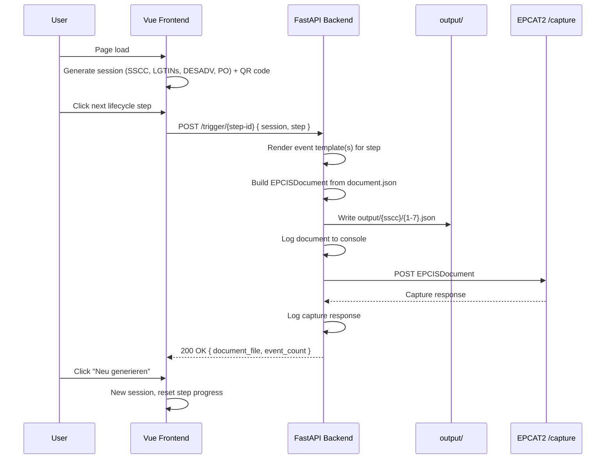

# Construct-X Demonstrator — Development Documentation

> Living document. Add notes, decisions, and learnings here as development progresses.

## Table of Contents

1. [Project Goal](#project-goal)
2. [System Overview](#system-overview)
3. [GS1 Identifiers & Session Data](#gs1-identifiers--session-data)
4. [Lifecycle Workflow](#lifecycle-workflow)
5. [Frontend](#frontend)
6. [Backend](#backend)
7. [EPCIS Templates](#epcis-templates)
8. [EPCAT Capture](#epcat-capture)
9. [Docker & Deployment](#docker--deployment)
10. [API Reference](#api-reference)
11. [Development Log](#development-log)

---

## Project Goal

Build a **demonstrator** for the Construct-X Dataspace that shows how construction materials can be tracked through their lifecycle using:

- **GS1 SSCC** identifiers encoded as **GS1 Digital Link** URIs
- **LGTINs**, **despatch advice**, and **purchase order** references as additional session identifiers
- **EPCIS 2.0** events generated from JSON templates and submitted as `EPCISDocument` payloads
- A web UI that simulates QR-code scans at each lifecycle stage

The demo is intentionally lightweight: no real dataspace connector — local document generation, file persistence, console logging, and POST to the EPCAT2 capture API.

---

## System Overview



### Design Principles

- **Simplicity over completeness** — the demo proves the concept, not production readiness
- **Template-driven events** — EPCIS payloads live in `backend/epcis/` and can be edited without code changes
- **One document per process step** — multiple events per step are wrapped in a single `EPCISDocument`
- **Sequential UI** — steps must be executed in order; only the next step is enabled
- **Observable output** — documents and capture responses are logged to the backend console and written to disk

---

## GS1 Identifiers & Session Data

On page load (and on **Neu generieren**), the frontend creates an **event session** with identifiers that stay stable for the whole demo run:

| Field | Format | Example |
|-------|--------|---------|
| `sscc` | `https://id.gs1.org/00/{18-digit-sscc}` | `https://id.gs1.org/00/006141411234567890` |
| `lgtin1` | `https://id.gs1.org/01/{gtin}/10/{lot}` | `https://id.gs1.org/01/04047111793267/10/a1b2` |
| `lgtin2` | `https://id.gs1.org/01/{gtin}/10/{lot}` | `https://id.gs1.org/01/04047111288459/10/c3d4` |
| `desadv` | `https://id.gs1.org/253/{reference}` | `https://id.gs1.org/253/40471113333333...` |
| `po` | `https://id.gs1.org/253/{reference}` | `https://id.gs1.org/253/40471112222221...` |

Implementation: `frontend/src/utils/epcis-session.ts`

- SSCC uses a valid GS1 check digit
- Both LGTINs share the same randomly generated lot per session
- DESADV and PO use fixed GTIN prefixes with random suffixes

The QR code encodes the SSCC Digital Link URI. The **Verwendete Daten Anzeigen** button opens a modal listing all current session values plus step progress.

---

## Lifecycle Workflow

The demonstrator models a circular material flow in construction, grouped into two stories:

```
Einbau:   Hersteller → Baustelle → Einbau          (steps 1–3)
Rückbau:  Rückbau → Baustelle → Hersteller → Aufbereitung   (steps 4–7)
```

| # | Step ID | Label | Event templates | Events | Output file |
|---|---------|-------|-----------------|--------|-------------|
| 1 | `ausgang-hersteller` | Ausgang beim Hersteller | `01.json`, `02a.json`, `03.json`, `04.json` | 4 | `1.json` |
| 2 | `baustellen-eingang` | Baustellen-Eingang | `05.json` | 1 | `2.json` |
| 3 | `einbau` | Einbau | `06a.json`, `06b.json` | 2 | `3.json` |
| 4 | `rueckbau` | Rückbau | `07a.json` | 1 | `4.json` |
| 5 | `ausgang-baustelle` | Ausgang Baustelle | `07b.json`, `08.json` | 2 | `5.json` |
| 6 | `eingang-hersteller` | Eingang beim Hersteller | `09.json` | 1 | `6.json` |
| 7 | `aufbereitung` | Aufbereitung | `02b.json` | 1 | `7.json` |

Step registry: `backend/epcis/steps.py`  
Frontend step definitions: `frontend/src/constants/steps.ts`

### Frontend Button Behaviour

- Only the **next** step in sequence is enabled; completed steps show a checkmark
- Clicking a step calls `POST /trigger/{step-id}` with the full session and timezone context
- On success, the step is marked completed and a snackbar shows the document file and event count
- **Neu generieren** creates a new session, re-renders the QR code, and resets all steps
- **Verwendete Daten Anzeigen** opens a modal with all session identifiers and progress

---

## Frontend

### Stack

| Tool | Version | Role |
|------|---------|------|
| Vue | 3.5 | UI framework |
| Vuetify | 4.x | Material Design components |
| Vite | 8.x | Build tool / dev server |
| qrcode.vue | 3.x | QR code rendering |
| TypeScript | 5.9 | Type safety |

### Key Files

| File | Responsibility |
|------|----------------|
| `src/pages/index.vue` | Main demo page: QR code, step buttons, progress, info modal |
| `src/utils/epcis-session.ts` | Session generation (SSCC, LGTINs, DESADV, PO) and step context |
| `src/constants/steps.ts` | Lifecycle step IDs, labels, and images |
| `src/services/trigger.service.ts` | HTTP client for `POST /trigger/{step-id}` |
| `src/config/env.ts` | Backend base URL from env |

### Environment variables

| Mode | Env file |
|------|----------|
| `development` | `frontend/.env.development` |
| `production` | `frontend/.env.production` |

| Variable | Development | Production |
|----------|-------------|------------|
| `VITE_BACKEND_BASE_URL` | `http://localhost:8000` | `https://demonstrator.example.com/api` |

Use `import { env } from '@/config/env'` in code. Local overrides: `.env.local` or `.env.development.local` (gitignored).

---

## Backend

### Stack

| Tool | Version | Role |
|------|---------|------|
| Python | 3.12 | Runtime |
| FastAPI | 0.115+ | Web framework |
| Uvicorn | 0.32+ | ASGI server |
| httpx | 0.28+ | EPCAT capture HTTP client |
| pydantic-settings | 2.6+ | Configuration |

### Application Structure

```
backend/
├── main.py                  # FastAPI app, routes, CORS
├── models.py                # Pydantic request/response models
├── config.py                # Settings, paths
├── health.py                # Readiness checks
├── output/                  # Generated EPCIS documents (gitignored)
├── epcis/
│   ├── generator.py         # Template rendering, document build, persist
│   ├── capture.py           # POST to EPCAT2 /capture
│   ├── steps.py             # Step registry (IDs, templates, document numbers)
│   ├── document.json        # EPCISDocument wrapper template
│   ├── 01.json … 09.json    # Individual event templates
│   └── 02a.json, 02b.json, 06a.json, 06b.json, 07a.json, 07b.json
├── epcis-original/          # Reference templates (not loaded at runtime)
├── Dockerfile / Dockerfile.dev
└── requirements.txt
```

### Document Generation Flow

1. Receive `POST /trigger/{step-id}` with `session` and `step` context
2. Validate step ID, session URIs, and timezone offset
3. For each event template assigned to the step:
   - Load template from `backend/epcis/{template}.json`
   - Substitute `$variables` (Python `string.Template`)
   - Assign staggered `eventTime` values (1 hour apart, oldest first) and fresh `eventID` UUIDs
4. Build an `EPCISDocument` using `document.json` with `$creationDate`
5. Write `backend/output/{sscc}/{number}.json` (number 1–7)
6. Log the full document JSON to stdout
7. POST the document to `{EPCAT_BASE_URL}/capture`
8. Log the capture response
9. Return `document_file` and `event_count`

### Persistence

| Path | Description |
|------|-------------|
| `backend/output/{sscc}/` | One folder per SSCC (18-digit value extracted from Digital Link) |
| `backend/output/{sscc}/{1-7}.json` | Full `EPCISDocument` for that lifecycle step |

Re-triggering the same step + SSCC **overwrites** the document file. The `output/` directory is gitignored.

### Environment variables

Loaded via `pydantic-settings` based on `APP_ENV`:

| `APP_ENV` | Env file |
|-----------|----------|
| `development` | `.env.development` |
| `production` | `.env.production` |

Local overrides: `.env.development.local` or `.env.local` (gitignored).

| Variable | Development | Production | Description |
|----------|-------------|------------|-------------|
| `LOG_LEVEL` | `DEBUG` | `INFO` | Console log level |
| `CORS_ORIGINS` | `http://localhost:3000,...` | `https://demonstrator.example.com` | Allowed frontend origins |
| `EPCAT_BASE_URL` | `https://epcat2.construct-x.prod-k8s.eecc.de/api` | same | EPCAT2 API base (capture URL = `{base}/capture`) |

Defaults: `OUTPUT_DIR=output` (relative to backend root).

---

## EPCIS Templates

Templates live in `backend/epcis/`. The folder `backend/epcis-original/` holds reference copies and is **not** used at runtime.

### Document wrapper (`document.json`)

Every process step produces one `EPCISDocument`:

```json
{
  "@context": [
    "https://ref.gs1.org/standards/epcis/2.0.0/epcis-context.jsonld",
    { "cx": "https://cx.com/epcis/cx-context.jsonld" }
  ],
  "type": "EPCISDocument",
  "schemaVersion": "2.0",
  "creationDate": "$creationDate",
  "epcisBody": {
    "eventList": []
  }
}
```

At generation time, `$creationDate` is substituted and `eventList` is filled with the rendered events.

### Event templates

Each file in `backend/epcis/` (except `document.json`) is a single EPCIS event. Substitution uses Python `string.Template` syntax (`$variable`).

| Placeholder | Replaced with |
|-------------|---------------|
| `$sscc` | GS1 Digital Link URI for the SSCC |
| `$lgtin1` | GS1 Digital Link URI for material class 1 |
| `$lgtin2` | GS1 Digital Link URI for material class 2 |
| `$desadv` | GS1 Digital Link URI for despatch advice |
| `$po` | GS1 Digital Link URI for purchase order |
| `$eventTime` | ISO 8601 UTC timestamp |
| `$eventTimeZoneOffset` | Browser timezone offset (e.g. `+02:00`) |
| `$eventID` | `urn:uuid:{uuid4()}` |

Event types used across templates include `TransactionEvent`, `ObjectEvent`, `TransformationEvent`, and `AggregationEvent`.

### Adding or changing a step

1. Add or edit event template JSON files in `backend/epcis/`
2. Register the step in `backend/epcis/steps.py` (`template_files`, `number`)
3. Add the button in `frontend/src/constants/steps.ts`

---

## EPCAT Capture

After persisting each document, the backend POSTs it to the EPCAT2 capture endpoint:

```
{EPCAT_BASE_URL}/capture
```

Example: `https://epcat2.construct-x.prod-k8s.eecc.de/api/capture`

Implementation: `backend/epcis/capture.py` (uses `httpx`)

- Request body: the full `EPCISDocument` JSON
- On HTTP error: API returns **502** (document is still persisted on disk)
- Capture response (status + body) is logged to the backend console
- `GET /ready` fails if `EPCAT_BASE_URL` is not configured

---

## Docker & Deployment

### Development (`docker-compose.yaml`)

| Service | Image | Port | Notes |
|---------|-------|------|-------|
| `backend` | `backend/Dockerfile.dev` | 8000 | Uvicorn with `--reload`, full bind mount |
| `frontend` | `frontend/Docker.dev` | 3000 | Vite dev server with HMR, full bind mount |

**Hot-reload without container restart:**

- `./backend` and `./frontend` are fully bind-mounted
- Backend entrypoint creates `.venv` in the mounted folder on first start and installs `requirements.txt`
- Re-run `pip install` inside the container when `requirements.txt` changes (or delete `backend/.venv`)

```bash
docker compose up --build
```

### Production

| Service | Dockerfile | Notes |
|---------|------------|-------|
| Backend | `backend/Dockerfile` | Slim Python image, Uvicorn, bakes in `.env.production` |
| Frontend | `frontend/Dockerfile` | Multi-stage: `npm build` → nginx serving `dist/` |

```bash
docker build -t demonstrator-backend ./backend
docker build -t demonstrator-frontend ./frontend
```

---

## API Reference

### `POST /trigger/{step-id}`

Generate an EPCIS document for a lifecycle step, persist it, and send it to EPCAT capture.

**Valid step IDs:** `ausgang-hersteller`, `baustellen-eingang`, `einbau`, `rueckbau`, `ausgang-baustelle`, `eingang-hersteller`, `aufbereitung`

**Request body:**

```json
{
  "session": {
    "sscc": "https://id.gs1.org/00/006141411234567890",
    "lgtin1": "https://id.gs1.org/01/04047111793267/10/a1b2",
    "lgtin2": "https://id.gs1.org/01/04047111288459/10/c3d4",
    "desadv": "https://id.gs1.org/253/40471113333333d3e4s4d5v",
    "po": "https://id.gs1.org/253/40471112222221a2b3c4d5f"
  },
  "step": {
    "eventTimeZoneOffset": "+02:00"
  }
}
```

**Success response (200):**

```json
{
  "step_id": "ausgang-hersteller",
  "sscc": "https://id.gs1.org/00/006141411234567890",
  "document_file": "1.json",
  "event_count": 4
}
```

**Error responses:**

| Status | Condition |
|--------|-----------|
| 404 | Unknown `step-id` or missing template file |
| 422 | Invalid session URIs or timezone offset |
| 502 | EPCAT capture endpoint error or unreachable |
| 500 | File system error |

### `GET /health`

Liveness probe — process is running.

```text
ok
```

### `GET /ready`

Readiness probe. Returns `503` when `EPCAT_BASE_URL` is missing, templates are missing, or `output/` is not writable.

```text
ok
```

---

## Development Log

### 2026-07-16 — EPCIS documents, EPCAT capture, UI polish

**Implemented:**

- Event templates render into `EPCISDocument` payloads via `document.json`
- One document per process step, persisted as `output/{sscc}/{1-7}.json`
- POST to EPCAT2 `{EPCAT_BASE_URL}/capture`; response logged to console
- Full session model: SSCC, LGTIN1, LGTIN2, DESADV, PO
- Sequential step execution in the UI with progress indicator
- Info modal (**Verwendete Daten Anzeigen**) for current session data
- Readiness check for `EPCAT_BASE_URL` and document template

### 2026-07-15 — Dev Docker setup

**Decisions made:**

- `Dockerfile.dev` runs dev servers (Vite, Uvicorn `--reload`) with bind-mounted source
- No container restart needed for code changes; rebuild image only on dependency changes
- Frontend `vite.config.ts` uses `server.watch.usePolling: true` for reliable HMR in Docker

### 2026-07-15 — Project kickoff

**Decisions made:**

- Vue 3 + Vuetify for the frontend
- Python FastAPI for the backend
- GS1 Digital Link format for identifiers
- Seven lifecycle steps model a circular construction material flow
- EPCIS events generated from JSON templates in `backend/epcis/`
- Separate Dockerfiles for dev and prod

**Open items:**

- [ ] Production compose / orchestration setup
- [ ] Construct-X Dataspace connector integration (out of scope for demo)
- [ ] `GET /events/{sscc}` endpoint to inspect generated documents via API

---

*Add new dated entries above this line as development continues.*
